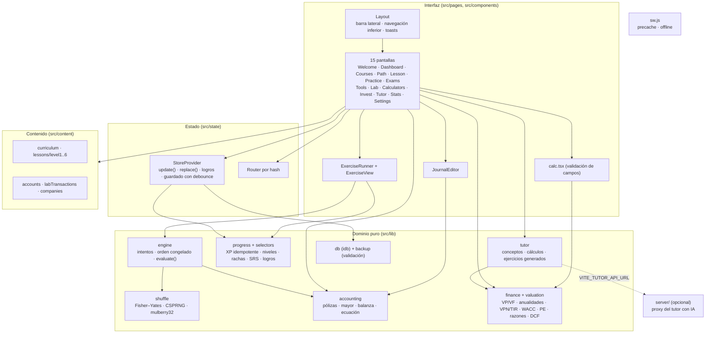

# FINCORE — Arquitectura

## Decisiones

| Decisión | Motivo |
|---|---|
| SPA estática (React 19 + TypeScript + Vite) sin backend obligatorio | Todo el aprendizaje funciona sin cuenta y sin conexión; despliegue en cualquier hosting estático |
| Rutas por hash (`#/ruta`) y `base: './'` | Funciona en subcarpetas, previsualizaciones y hosting sin reescrituras |
| Estado en un solo documento `AppState` en IndexedDB | Simplicidad, exportación/importación trivial, sin datos personales |
| Lógica de dominio en funciones puras (`src/lib`) | Determinismo y pruebas unitarias sin DOM |
| Errores financieros como `Result<T>` con código | Nunca se inventa un resultado: la UI muestra el motivo |
| Service worker generado en build (`sw-plugin.ts`) | Precarga exacta de los archivos compilados; sin dependencias extra |
| Pantallas pesadas con carga diferida (Lab, Calculadoras, Inversión, Tutor) | Primer render más ligero en móvil |

## Componentes



## Flujo de datos de un ejercicio

```mermaid
sequenceDiagram
  participant U as Estudiante
  participant R as ExerciseRunner
  participant E as engine
  participant S as Store
  participant P as progress
  participant D as IndexedDB
  R->>S: ¿hay intento activo para la lección?
  alt no hay
    R->>E: createAttempt(lección, ejercicios)
    E-->>R: Attempt {orders: ids barajados (Fisher–Yates)}
    R->>S: update(ensureAttempt)
  end
  R->>E: orderedOptions(ej, intento)  (mismo orden en cada render)
  U->>R: elige opción (por ID)
  U->>R: Comprobar
  R->>E: evaluate(ej, {optionId})
  E-->>R: Evaluation {correct, score, feedback}
  R->>S: update(recordAnswer)
  S->>P: bloquea la respuesta, registra, SRS, XP con clave "ex:ID"
  S->>P: checkAchievements
  S-->>D: guardado (debounce 250 ms; flush al ocultar la página)
  U->>R: Ver resultados
  R->>S: update(finishLesson) → "lesson:ID" +50, "perfect:ID" +25
```

## Reglas clave

- **Barajado.** Cada intento guarda en `attempt.orders` el orden de opciones (`exId`), espacios de fórmula (`exId:blankId`), elementos a clasificar (`exId:items`) y cuentas del selector (`exId:accounts`). Volver a renderizar, seleccionar, ver retroalimentación o recargar la página no cambia el orden; solo «Nuevo intento» baraja de nuevo. La respuesta se guarda como ID de opción, nunca como posición.
- **XP sin duplicados.** `awardXp(estado, clave, xp)` no hace nada si la clave ya existe. Claves: `ex:ID` (una vez en la vida), `review:ID:día`, `lesson:ID`, `perfect:ID`, `exam-pass:clave`, `lab:TX`. Además, la primera respuesta de cada ejercicio en un intento queda bloqueada.
- **Pólizas.** `checkJournal` agrega por cuenta y naturaleza; una póliza es correcta solo si cuadra, las cuentas y naturalezas coinciden y los importes coinciden (±0.005).
- **Finanzas.** Todas las funciones validan entradas y devuelven `{ok:false, error}` en casos límite: sin TIR (`NO_SIGN_CHANGE`, `IRR_NOT_FOUND`), varias TIR (`multiple: true`), tasa ≤ −100 %, flujos insuficientes, división entre cero, `g ≥ WACC`, precio ≤ costo variable, etc.
- **Persistencia.** `loadState` valida el documento; si está dañado o IndexedDB no existe (modo privado), la app usa memoria y lo indica en Configuración. La importación valida tipos, rangos, tamaño (5 MB) y bloquea claves como `__proto__`.
- **PWA.** `sw.js` precarga todos los archivos del build; recursos con *cache-first* y navegación con *network-first* y respaldo en caché.
- **Seguridad del tutor.** La clave de la API solo existe en el servidor (`ANTHROPIC_API_KEY`); el navegador solo conoce la URL del proxy.
